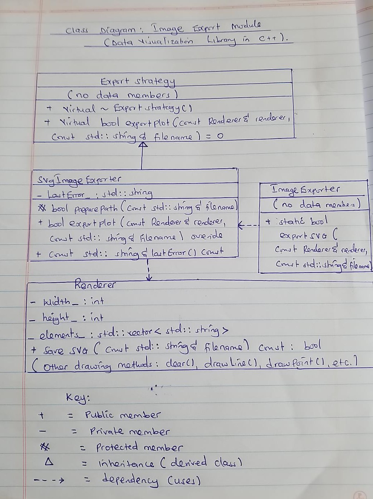
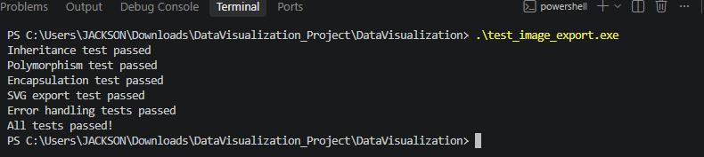
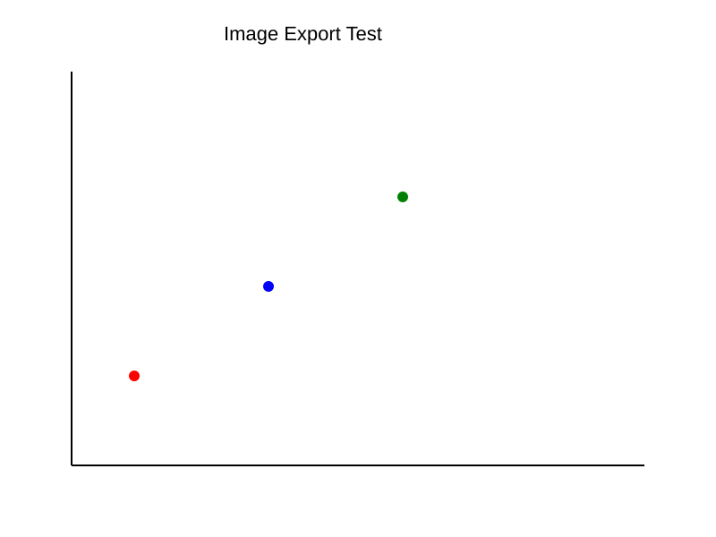

 MAKERERE UNIVERSITY
 COLLEGE OF ENGINEERING, DESIGN, ART AND TECHNOLOGY
 DATA VISUALIZATION LIBRARY IN C++
 WEEKLY INDIVIDUAL PROGRESS REPORT

Student:YABA JACKSON GERMAN     25/E/08794/PS          BCCE  
Module: Image Export  
Project: Data Visualization Library in C++  
Programming Language: C++  
Development Environment: Visual Studio Code  
Reporting Week: Week three  
Git Branch: `jackson-data-loading`

 1. INTRODUCTION

This report documents the design and implementation of the Image Export module in the Data Visualization Library in C++.

The Image Export module is responsible for saving plots generated by the rendering system into SVG image files.

The implementation demonstrates three fundamental object-oriented programming concepts required by the course: **encapsulation, inheritance, and polymorphism**. It also demonstrates abstraction and modular software design.

The module integrates with the existing `Renderer` class without modifying its public interface.

 2. OBJECTIVES

The objectives of this week's work are:

1. Implement an Image Export module in C++.
2. Save rendered plots in SVG format.
3. Support user-specified output filenames and paths.
4. Validate filenames and handle export failures.
5. Demonstrate encapsulation, inheritance, and runtime polymorphism.
6. Integrate the module with the existing Renderer.
7. Develop tests for successful and unsuccessful exports.
8. Document the class layouts and relationships.

 3. IMPLEMENTATION FILES

| File | Purpose |
|---|---|
| `include/dataviz/ImageExporter.h` | Declares the export classes and interfaces |
| `src/ImageExporter.cpp` | Implements filename validation and SVG export |
| `tests/test_image_export.cpp` | Tests the exporter and OOP functionality |
| `include/dataviz/Renderer.h` | Existing graphical rendering interface |
| `src/Renderer.cpp` | Existing rendering and SVG-writing implementation |

 4. OBJECT-ORIENTED PROGRAMMING CONCEPTS

 4.1 Encapsulation

Encapsulation is the process of combining data members and member functions within a class while restricting direct access to internal data.

In this project, encapsulation is demonstrated by the `SvgImageExporter` class.

The class contains a private data member:

```cpp
private:
    std::string lastError_;
```

This variable stores the most recent error message generated during an export operation.

Because `lastError_` is private, external functions cannot directly modify it.

Instead, the class provides a public getter:

```cpp
const std::string& lastError() const;
```

The getter provides controlled, read-only access to the error information.

The class also contains a protected member function:

```cpp
protected:
    bool preparePath(const std::string& filename);
```

This function validates the output filename before saving a plot. In the current implementation, it checks that the filename is not empty and ends with `.svg`.

Importance of encapsulation:

- Protects internal data from direct modification.
- Controls access to implementation details.
- Improves maintainability.
- Makes error handling easier to manage.

 4.2 Inheritance

Inheritance is an object-oriented programming mechanism that allows a derived class to acquire or extend the interface and behavior of a base class.

The Image Export module demonstrates inheritance using two classes:

Base class: `ExportStrategy`

Derived class: `SvgImageExporter`

The inheritance relationship is declared as:

```cpp
class SvgImageExporter : public ExportStrategy
```

The `public` inheritance specifier means that `SvgImageExporter` publicly inherits the interface defined by `ExportStrategy`.

The base class declares a pure virtual function:

```cpp
virtual bool exportPlot(
    const Renderer& renderer,
    const std::string& filename
) = 0;
```

The derived class overrides this function:

```cpp
bool exportPlot(
    const Renderer& renderer,
    const std::string& filename
) override;
```

This allows the derived class to provide the actual SVG export functionality while following the common interface.

Importance of inheritance:

- Encourages reuse of common interfaces.
- Supports extensibility.
- Establishes relationships between related classes.
- Allows specialized implementations.

 4.3 Polymorphism

Polymorphism is the ability of objects belonging to different derived classes to be accessed through a common base-class interface.

The module demonstrates runtime polymorphism through virtual functions.

A concrete exporter object is created:

```cpp
SvgImageExporter svgExporter;
```

A base-class reference is assigned to that object:

```cpp
ExportStrategy& exporter = svgExporter;
```

The export function is called through the base-class reference:

```cpp
exporter.exportPlot(
    renderer,
    "jackson_plot.svg"
);
```

Because `exportPlot()` is virtual and overridden, C++ invokes the implementation provided by `SvgImageExporter`.

This mechanism is called **dynamic dispatch**.

Although the current implementation has only one concrete export strategy, the architecture allows additional export strategies to be introduced in the future.

Importance of polymorphism:

- Improves software flexibility.
- Allows different implementations to share an interface.
- Reduces dependence on concrete classes.
- Supports future extensions.

 4.4 Abstraction

Abstraction is the process of exposing essential operations while hiding internal implementation details.

The `ExportStrategy` class is abstract because it declares a pure virtual function.

The user of the export interface does not need to know how the file is written internally.

The exporter provides a simple operation:

```cpp
exportPlot(renderer, filename);
```

Internally, the SVG exporter validates the filename and delegates image writing to `Renderer::saveSVG()`.

 5. CLASS LAYOUTS AND ACCESS SPECIFIERS

The hand-drawn class diagram is provided in Appendix A.

 5.1 ExportStrategy

`ExportStrategy` is the abstract base class.

Public member functions:

- `virtual ~ExportStrategy()`
- `virtual bool exportPlot(...) = 0`

It declares no data members.

 5.2 SvgImageExporter

`SvgImageExporter` publicly inherits from `ExportStrategy`.

Private data member:

- `std::string lastError_`

Protected member function:

- `bool preparePath(const std::string& filename)`

Public member functions:

- `bool exportPlot(...) override`
- `const std::string& lastError() const`

5.3 ImageExporter

`ImageExporter` provides a convenient static interface for other project modules.

Public member function:

- `static bool exportSVG(...)`

It declares no data members and has no inheritance relationship with `ExportStrategy`.

 5.4 Renderer

The `Renderer` class provides graphical drawing and SVG-writing functionality.

Private members include:

- `int width_`
- `int height_`
- `std::vector<std::string> elements_`
- `static std::string escapeXML(...)`
- `static bool finite(double)`

Public member functions include:

- `Renderer()`
- `clear()`
- `drawLine()`
- `drawPoint()`
- `drawRectangle()`
- `drawText()`
- `drawAxes()`
- `drawScatter()`
- `drawPolyline()`
- `drawBars()`
- `saveSVG()`

The exporter uses the Renderer through a dependency relationship rather than inheritance.

 6. MODULE INTEGRATION

The Image Export module works with the existing Plot Rendering module developed by Adrian and the group.

The integration process follows these steps:

1. A Renderer object is created.
2. Graphical elements are drawn using Renderer functions.
3. An SvgImageExporter object is created.
4. The exporter validates the output filename.
5. The exporter calls `Renderer::saveSVG()`.
6. The renderer writes the SVG file to the specified destination.
7. The exporter returns a Boolean value indicating success or failure.

The current implementation uses standard C++ string handling and file-writing functionality without `<filesystem>`.

Output directories must already exist before an image is saved.

 7. TESTING AND VALIDATION

The test program is designed to verify the following:

| Test | Expected Result |
|---|---|
| Inheritance | SvgImageExporter inherits from ExportStrategy |
| Polymorphism | Virtual function dispatch works through a base-class reference |
| Encapsulation | Error messages are accessed using the public getter |
| SVG export | Valid SVG file is generated |
| File verification | Generated file can be opened and contains SVG markup |
| Empty filename | Export is rejected |
| Unsupported extension | Non-SVG filename is rejected |
| Convenience interface | ImageExporter successfully delegates SVG export |

Compilation command:

```powershell
g++ -std=c++11 -Iinclude src/Renderer.cpp src/ImageExporter.cpp tests/test_image_export.cpp -o test_image_export.exe
```

Execution command:

```powershell
.\test_image_export.exe
```

Actual test results: [Insert results after running the program.]

Evidence: [Insert terminal screenshot and exported SVG image.]

 8. CHALLENGES AND SOLUTIONS

 Challenge 1: Demonstrating runtime polymorphism

A static export function alone does not demonstrate runtime polymorphism.

Solution: An abstract base class named `ExportStrategy` and a derived class named `SvgImageExporter` were introduced. The derived class overrides the virtual export function.

 Challenge 2: Compatibility with the development environment

The original implementation used `<filesystem>`, which was not recognized correctly in the configured development environment.

Solution: The module was revised to use standard string operations and the existing Renderer file-writing function, avoiding the filesystem library.

 Challenge 3: Maintaining compatibility with the Renderer

The Image Export module depends on the Renderer developed by another group member.

Solution: The existing `Renderer::saveSVG()` function was reused without modifying the public rendering interface.

 Challenge 4: Handling invalid output requests

Export operations may fail because of empty filenames, unsupported extensions, missing directories, or file-writing problems.

Solution: Filename validation was implemented, and export failures are reported through Boolean return values and stored error messages.

 9. FUTURE IMPROVEMENTS

Future improvements may include:

1. Supporting additional image formats.
2. Adding automatic directory creation when the development environment supports it.
3. Providing more detailed error reporting.
4. Adding more concrete export strategies.
5. Integrating image export with all supported plot types.
6. Improving automated testing.

 10. CONCLUSION

The Image Export module demonstrates practical application of encapsulation, inheritance, polymorphism, and abstraction in C++.

Encapsulation protects the internal error information of the `SvgImageExporter` class. Inheritance establishes a relationship between the abstract `ExportStrategy` class and its concrete implementation. Runtime polymorphism enables export operations to be invoked through a base-class reference.

The module also integrates with the existing Renderer to save graphical visualizations in SVG format.

This design supports modular development and provides a foundation for future extensions of the Data Visualization Library.


---

 APPENDIX A: HAND-DRAWN CLASS DIAGRAM



Figure A1: Hand-drawn class layout illustrating encapsulation, inheritance, polymorphism, access specifiers, and class dependencies.

APPENDIX B: PROGRAM OUTPUT




Figure B1: Successful execution of inheritance,
polymorphism, encapsulation, SVG export,
and error-handling tests.
All tests passed successfully.

---

 APPENDIX C: GENERATED SVG IMAGE



Figure C1: SVG plot displaying three data points
successfully rendered and exported by the Image Export module.

The output demonstrates successful integration of the
Renderer and ImageExporter classes.


